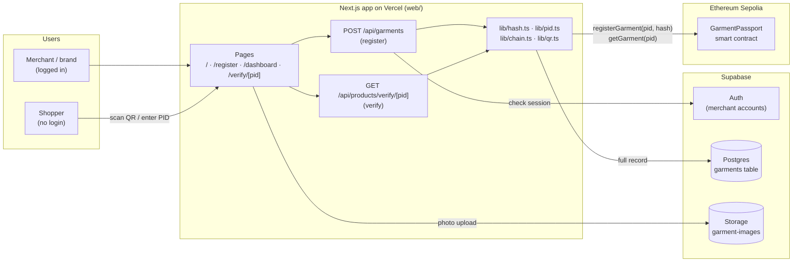
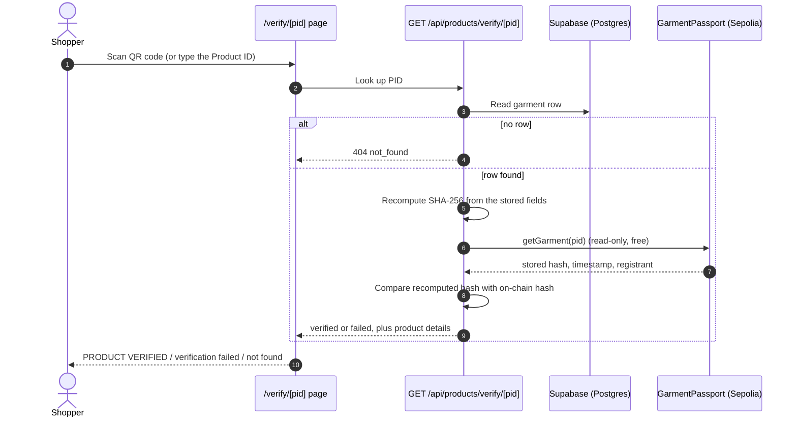

# ThreadMark

ThreadMark is a project that helps people check whether a garment is genuine and learn where it comes from. It gives each product a digital identity so brands, artisans, and customers can verify important details with a simple QR code scan.

The idea behind ThreadMark is to make fashion more transparent and trustworthy. It is especially useful for protecting original designs, reducing fake products, and helping small textile brands show proof of authenticity in a simple and affordable way.

**Live app:** https://threadmark-dpp.vercel.app
**Smart contract (Sepolia testnet):** [`0xF0d9E12561e14d8b5E64a5a21A6305F089FCa75f`](https://sepolia.etherscan.io/address/0xF0d9E12561e14d8b5E64a5a21A6305F089FCa75f)

## What it does

- Gives every garment its own digital record (a "Digital Product Passport")
- Lets users scan a QR code to check product authenticity
- Helps track product origin and manufacturing details
- Supports trust, transparency, and better product traceability

## Why it matters

Counterfeit clothing and unclear product information are major challenges in the textile industry. ThreadMark aims to make it easier for customers to trust what they buy, while also helping brands and artisans protect their work and prepare for growing global transparency requirements.

## Project goal

This project is built as a practical step toward a Digital Product Passport system for garments, with a focus on authenticity, transparency, and support for the textile industry.

---

## How it works, in one paragraph

A merchant logs in and fills in five details about a garment: brand, SKU, fabric, origin and manufacturing date. ThreadMark turns those details into a **SHA-256 fingerprint** (a 64-character code that changes completely if even one letter of the details changes). The full details go into a normal database, but only the fingerprint is written to the **Ethereum blockchain**, where nobody can edit or delete it. The merchant gets a **QR code** to print on the label. When a shopper scans it, ThreadMark recomputes the fingerprint from the database and compares it with the one on the blockchain: if they match, the garment is shown as **verified**; if anyone changed the database record, the fingerprints differ and it is shown as **failed**.

## System architecture



**Why two places to store data?** Writing to a blockchain costs a fee for every byte, so storing whole product records there would be slow and expensive. ThreadMark keeps the readable details (and photos) in Supabase, and keeps only a 32-byte fingerprint on-chain. The blockchain copy cannot be changed, so it acts as the tamper-proof reference that the database is checked against.

## Registering a garment

1. The merchant logs in and fills in brand, SKU, fabric, origin and manufacturing date (a photo is optional and goes to Supabase Storage).
2. `POST /api/garments` checks the login, validates the fields and rejects a SKU that is already registered.
3. The five fields are normalised (spaces trimmed, brand/fabric/origin lowercased, SKU uppercased), joined with `|` and hashed with SHA-256 by `computeHash` in `web/lib/hash.ts`. The photo is not part of the hash.
4. A Product ID is generated, e.g. `TM-7K3QX9PD2A` (`TM-` plus 10 characters with no look-alikes such as `I`, `O`, `0`, `1`), and the row is saved with status `pending`.
5. The hash is written to the smart contract with `registerGarment(pid, hash)`. On success the row becomes `confirmed` and a QR code for `/verify/<PID>` is returned; if the chain write fails the row is marked `failed` and no QR code is issued.

## Verifying a garment



Registration and verification call the same `computeHash` function, so the two sides can never disagree about how the fingerprint is made. If someone edits a garment's details in the database, the recomputed hash no longer matches the one on the blockchain and the result is **failed**.

## Data storage

- **Supabase Postgres, `garments` table** (`database/schema.sql`): PID, SKU, brand, fabric, origin, manufacturing date, photo path, SHA-256 hash, transaction hash, status (`pending` / `confirmed` / `failed`), QR link, registering merchant and time. Row-level security is on with no public policies, so the browser cannot touch the table; all reads and writes go through the server API routes.
- **Supabase Storage, `garment-images` bucket** (`database/storage.sql`): optional garment photos, public read, logged-in upload, JPG/PNG/WebP up to 2 MB.
- **Ethereum Sepolia, `GarmentPassport` contract**: for each PID, only the 32-byte hash, the block timestamp and the registering wallet address.

## Smart contract

`blockchain/contracts/GarmentsPassport.sol` (contract `GarmentPassport`, Solidity 0.8.28):

| Function | What it does |
| --- | --- |
| `registerGarment(string pid, bytes32 dataHash)` | Stores the hash, block timestamp and sender address. Reverts with `pid required` for an empty ID and `garment already exists` for a repeat, so a record can never be overwritten. |
| `getGarment(string pid)` | Returns `(dataHash, timestamp, registrant)`. An unknown PID returns `timestamp = 0`. Reading is free. |
| `GarmentRegistered` event | Emitted on every successful registration. |

Deployed on Sepolia (chain ID 11155111) at `0xF0d9E12561e14d8b5E64a5a21A6305F089FCa75f`. See `blockchain/contract-handover.md` for the deployment transaction and integration notes.

## Tech stack

| Layer | Technology |
| --- | --- |
| Web app and API | Next.js 16 (App Router), React 19, TypeScript, Tailwind CSS 4 |
| Hosting | Vercel |
| Database, auth, file storage | Supabase (Postgres, Auth, Storage) |
| Blockchain | Solidity 0.8.28, Hardhat 3, Hardhat Ignition, ethers v6, Ethereum Sepolia testnet |
| QR codes | `qrcode` (generate), `jsqr` (scan from camera or uploaded image) |
| Tests | Vitest (web), Mocha + Chai via Hardhat (contract) |

## Repository layout

```
ThreadMark/
├── web/                    Next.js app (pages, API routes, all app logic)
│   ├── app/                Pages: / (scan + merchant login), register, dashboard, verify/[pid]
│   │   └── api/            POST /api/garments, GET /api/products/verify/[pid]
│   ├── lib/                hash, pid, chain, qr, auth, validation, database access (+ tests)
│   ├── scripts/seed.ts     Seeds sample garments from fixtures/
│   └── fixtures/           Sample garment data
├── blockchain/             Hardhat project
│   ├── contracts/          GarmentPassport smart contract
│   ├── test/               Contract tests
│   ├── ignition/           Deployment module and recorded deployments
│   └── abi/                ABI used by the web app
├── database/               schema.sql (garments table), storage.sql (photo bucket)
└── .env.example            Every environment variable the project needs
```

## Running locally

You need Node.js 20 or newer and a Supabase project.

1. **Database.** In the Supabase SQL editor, run `database/schema.sql`, then `database/storage.sql`. Create a merchant user under Authentication.
2. **Environment.** Copy `.env.example` to `web/.env.local` and fill in the Supabase values. Leave `CHAIN_MODE=mock` to use a local stand-in chain (stored in `web/.mock-chain.json`) instead of Sepolia.
3. **Run the app.**
   ```bash
   cd web
   npm install
   npm run dev        # http://localhost:3000
   ```
4. **Use the real blockchain (optional).** Set `CHAIN_MODE=real` and fill in `SEPOLIA_RPC_URL`, `SEPOLIA_PRIVATE_KEY` (a funded Sepolia test wallet) and `CONTRACT_ADDRESS`.

Never commit `.env`, `.env.local` or private keys; they are already in `.gitignore`.

## Tests

```bash
cd web && npm test               # Vitest: hashing, PIDs, validation, registration, verification API, auth, QR parsing
cd blockchain && npx hardhat test   # Contract: registration, duplicates, empty PID, read-back, immutability
```

## Deploying the contract

```bash
cd blockchain
npm install
npx hardhat ignition deploy ignition/modules/GarmentPassport.ts --network sepolia
```

Hardhat reads `SEPOLIA_RPC_URL` and `SEPOLIA_PRIVATE_KEY` from the `.env` file at the repository root. Copy the new address into `CONTRACT_ADDRESS` for the web app.
